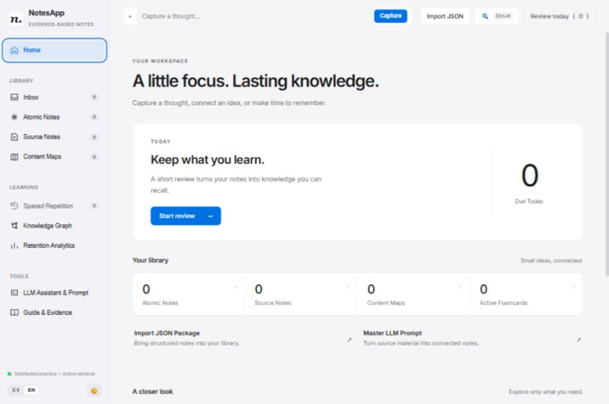
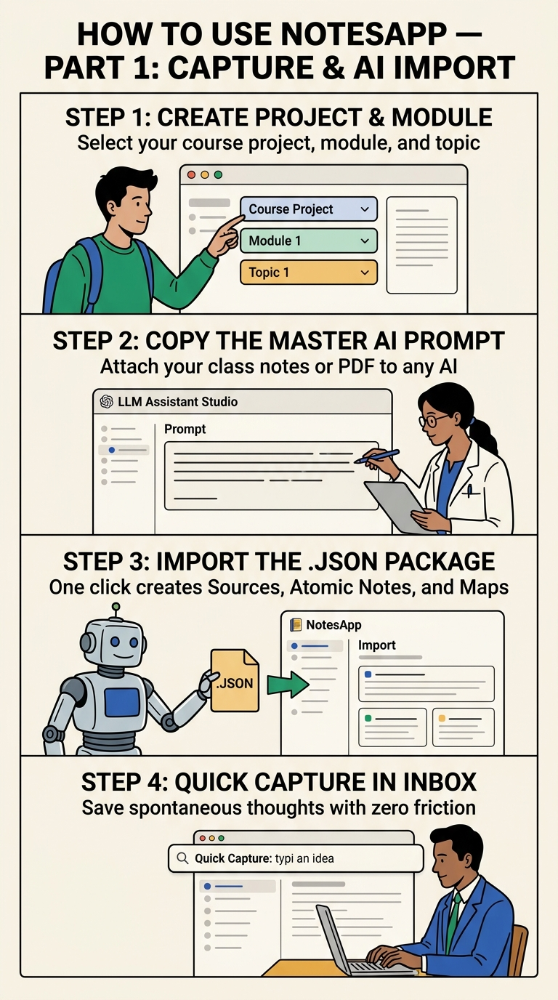
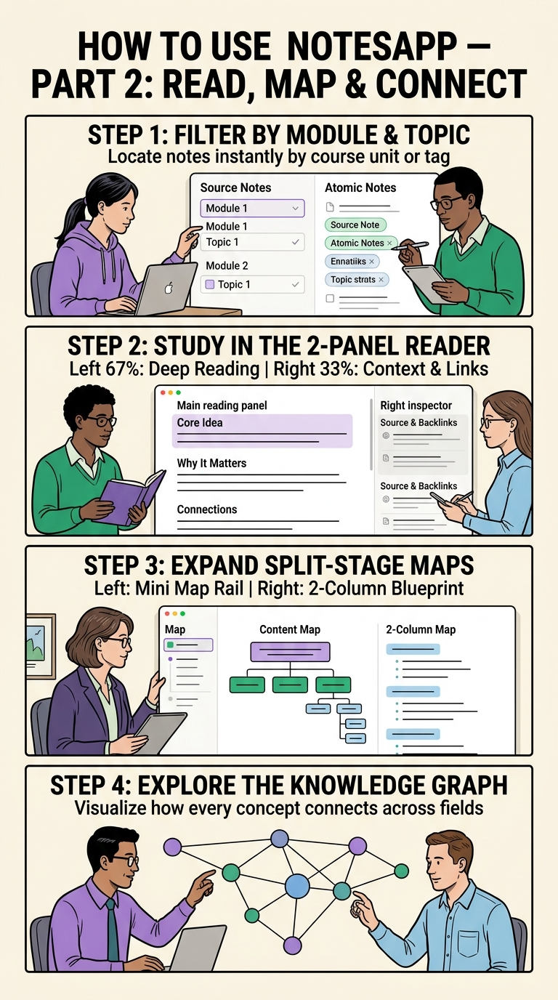
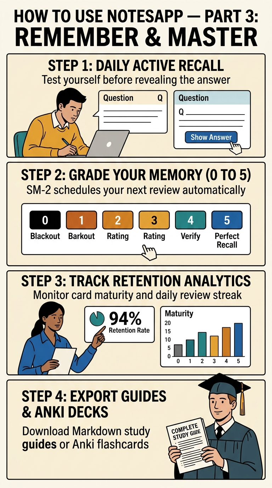

# 🧠 NotesApp — Second Brain, Atomic Notes (Zettelkasten) & Spaced Repetition (SM-2)

**Capture ideas. Distill atomic concepts. Connect knowledge maps. Remember everything you learn.**

NotesApp is a **local-first desktop & browser application** for building a personal knowledge base grounded in cognitive science (**Zettelkasten** atomic note-taking, **Feynman** synthesis, **Content Maps**, and **SM-2 Spaced Repetition** with topic interleaving). All your notes live on your computer as plain, portable **Markdown (`.md`)** files with YAML frontmatter—no cloud lock-in, no account required.

English is the default interface language, with instant **EN / ES** switching and bilingual AI import prompts.



---

## 🚀 Quick Install for Windows (`.exe` Installer)

This repository includes a **standalone Windows Setup Installer** that bundles the complete application and runtime—**no prior Node.js or command-line setup required**.

### Option A — Official Windows Installer (`NotesApp-Setup-1.0.0.exe`)
1. Download **[`NotesApp-Setup-1.0.0.exe`](NotesApp-Setup-1.0.0.exe)** from this repository.
2. Double-click **`NotesApp-Setup-1.0.0.exe`**.
3. Choose your installation folder (defaults to `%LocalAppData%\Programs\NotesApp`), select whether to create **Desktop** and **Start Menu** shortcuts, and click **Install Now**.
4. **NotesApp** launches automatically in a dedicated desktop app window with a **System Tray icon** (right-click the tray icon anytime to open NotesApp, open your Markdown data folder, or exit cleanly).
5. Includes a built-in uninstaller (`Uninstall-NotesApp.exe`) registered in Windows *Installed Apps*.

> **Silent Install Support:** You can also run `NotesApp-Setup-1.0.0.exe /S` (or `/S /D=C:\CustomPath`) for automated silent deployment.

### Option B — Direct Desktop Launcher (`NotesApp.exe` or `iniciar-notesapp.bat`)
- If you cloned or extracted this repository on a Windows machine with Node.js installed, simply double-click **`NotesApp.exe`** (or **`iniciar-notesapp.bat`**) in the project root.

### Option C — Developer / Cross-Platform CLI (`Node.js 20+`)
```bash
npm ci
npm start
```
Then open **[http://localhost:3456](http://localhost:3456)** in your browser.

---

## ✨ What's New in This Version

### 1. Calm, De-Cluttered **Atomic Notes** with Progressive Disclosure
- **Minimalist 5-Element Grid Cards:** Each card in the **Atomic Notes** gallery displays only what matters for rapid scanning:
  1. **Project Badge** (e.g., *WBS School Coding - AI Agents & Automations*)
  2. **Module Pill** (e.g., *📦 Module 1 - Intro to AI*)
  3. **Note Title**
  4. **Origin Source** (*📖 Source Note title*)
  5. **2-Line Core Idea Snippet**
- **Collapsible Folders Drawer (`📁 Folders`):** The folder & curriculum tree stays tucked away by default so the note grid breathes across the full viewport, opening on demand with a single click.
- **In-Place Split-Stage Expansion & Progressive Disclosure:** Clicking any atomic note smoothly shifts the remaining notes into a quiet left navigation rail and expands the selected note into a serene reading stage:
  - **Immediate Focus:** Shows the header context, **💡 Core Idea**, and **🎯 Why It Matters** without visual clutter.
  - **On-Demand Deep Dive Tabs:** Secondary layers stay neatly folded into three interactive pill tabs at the bottom of the note:
    - **`🧠 Self-Test Question`** — Practice active recall and reveal the answer inline.
    - **`🔗 Connections & Maps (N)`** — Read *How It Connects*, jump to linked atomic notes, or open participating Content Maps.
    - **`🧭 Context & Tags`** — Inspect the full curriculum path (*Field → Project → Module → Topic → Folder*) and `#hashtags`.

### 2. Split-Stage Master-Detail **Content Maps**
- **Compact Folded Tiles:** When browsing **Content Maps**, cards stay compact—showing only map type (*🎓 Master Course Map* vs. *🗺️ Topic Map*), title, project/module pills, and concept counters.
- **Full-Height Lateral Expansion:** Clicking any map moves all other maps into a `280px` sticky left switcher rail and expands the active map across a 4-zone architectural canvas:
  1. **Command Header** with map badges, Study Guide `.md` export, Edit, and `✕ Close Map`.
  2. **Map Thesis & 3 KPI Counters** (*Atomic Concepts*, *Active Recall Qs*, *Thematic Sub-Maps*).
  3. **Course Thematic Sub-Maps Panel** (on Master Course Maps) to jump directly to any lesson's sub-map.
  4. **2-Column Numbered Concept Blueprint** displaying each atomic concept, its connection rationale (`Why it belongs here`), and its core idea preview.

### 3. Dual-Window Reader for **Source Notes**
- Opening a **Source Note** presents a side-by-side 2-window workspace:
  - **Left Primary Window (67%):** Bibliographic header, paraphrased key takeaways, and verbatim highlights/quotes.
  - **Right Inspector Window (33%):** Extracted **Atomic Notes**, linked **Content Maps**, curriculum hierarchy, and tags.

### 4. Calibrated Anti-Halation **Dark Mode** (Obsidian Slate & WCAG AAA Contrast)
- Engineered by a 3-expert color & ocular ergonomics committee to eliminate astigmatic halation (white-on-pure-black glare) during long study sessions:
  - **3-Tier Obsidian Slate Surfaces:** `#0f1218` app canvas → `#171c26` elevated cards with subtle top specular highlights → `#1c2331` inner reading pillars.
  - **Soft Ivory Typography (`#e6edf5` & `#dde6f0`):** Delivers **13.2:1 AAA contrast** without eye strain, reserving pure bright `#f8fafc` for bolded key terms.
  - **Luminous Semantic Pills (`>7.5:1 AAA`):** High-contrast pastel badges for Projects (`#e9d5ff`), Modules (`#6ee7b7`), Sources (`#93c5fd`), and Flashcards (`#fde68a`).
  - **Three Theme Modes:** Cycle effortlessly between **☀️ Light**, **🌙 Dark (Obsidian Slate)**, and **🎨 Pastel (Warm Cream)**.

### 5. Visual Section Identity & 3 Vertical Step-by-Step Infographics
- Every workspace section features a cohesive *Ligne Claire* editorial illustration for instant visual wayfinding.
- The **System Guide** includes a 3-poster vertical infographic series (`9:16`) explaining the complete workflow in plain, human English:

| Part 1: Capture & AI Import | Part 2: Study & Connect | Part 3: Remember & Master |
| :---: | :---: | :---: |
|  |  |  |

---

##🧭 Core Workflow

1. **📥 Capture or Import (`Inbox` / `Import JSON`):**
   - Jot quick fleeting ideas into the top bar or **Inbox**, or use **LLM Assistant & Prompt** to convert raw lecture transcripts, PDFs, or articles into a structured JSON package of Source Notes, Atomic Notes, Content Maps, and SM-2 Flashcards.
   - **Incremental Course & Project Import:** Import new modules or lessons directly into an existing **Field** and **Project / Course** (`📦 Module` → `📖 Subtopic`) without duplicating projects.
2. **📚 Synthesize References (`Source Notes`):**
   - Store books, videos, courses, and articles with paraphrased key points and verbatim quotes.
3. **⚛️ Distill Single Concepts (`Atomic Notes`):**
   - One self-contained idea per note (*Core Idea in your own words*, *Why it matters*, *How it connects*, plus an *Active Recall Question & Answer*).
4. **🗺️ Build Big-Picture Outlines (`Content Maps`):**
   - Connect atomic notes into Topic Maps and Master Course Maps. Every connection requires an explicit **reason** explaining how the concept fits the map.
5. **🧠 Retain Long-Term (`Spaced Repetition` & `Retention Analytics`):**
   - Review due flashcards with the **SM-2 algorithm** (graded `0–5` with topic interleaving), track your retention rate and card maturity in **Analytics**, or explore your **Interactive Knowledge Graph**.

---

## 🤖 Importing Notes with an External AI (LLM Prompt)

NotesApp includes a built-in master prompt (in English and Spanish) so you can use ChatGPT, Claude, or Gemini to extract rich notes from your study material—without needing any API key inside NotesApp:

1. Open **🤖 LLM Assistant & Prompt** in the sidebar.
2. Select **English** or **Spanish** and click **Copy Master Prompt**.
3. Paste the prompt into your preferred AI along with your study text or transcript.
4. Click **📥 Import JSON** in NotesApp, choose your target **Field** and **Project** (or create a new one), paste the JSON output, and click **Import Package**.

Standalone prompt files are also available in the repository root:
- [English LLM Import Prompt](PROMPT-LLM-IMPORT-EN.md)
- [Spanish LLM Import Prompt](PROMPT-LLM-IMPORTACION.md)

---

## 💾 Local Markdown Storage & Backups

By default, NotesApp stores your library in six plain-text folders alongside `server.js` (or in `%LocalAppData%\NotesApp\Data` if installed in a write-protected system directory):

```text
01-inbox/              Quick captures (.md)
02-source-notes/       Bibliographic references and source notes (.md)
03-atomic-notes/       Distilled atomic concepts and wikilinks (.md)
04-content-maps/       Master course maps and topic maps (.md)
05-self-assessment/    SM-2 flashcard questions, answers, and intervals (.md)
06-spaced-repetition/  Project hierarchy (proyectos.json), folders, and review logs
_templates/            Reusable Markdown templates
```

- **Exports:** Export flashcards as **Anki TSV** (`Spaced Repetition → Export to Anki`) or compile any Content Map into a complete **Markdown Study Guide** (`Content Maps → Study Guide .MD`).
- **Backups:** Simply copy the `01-inbox` through `06-spaced-repetition` folders to back up or migrate your entire knowledge base.

---

## ⌨️ Keyboard Shortcuts

| Shortcut | Action |
| :--- | :--- |
| `Ctrl + K` / `Cmd + K` | Open Global Search |
| `Escape` | Close active modal dialog |
| `Space` | Reveal flashcard answer during Spaced Repetition review |
| `0` – `5` | Grade recall quality during Spaced Repetition review |
| `+` / `-` / `0` | Zoom in, zoom out, or fit view in the Knowledge Graph |

---

## 🛠️ Development, Testing & Building the `.exe` Installer

### Run Automated Tests
```bash
npm test
```
Runs both the **Knowledge Graph math & collision suite** (`test-graph.cjs`, 8 unit tests) and the **full isolated API & regression suite** (`test-isolated.cjs`, 39 integration tests on an isolated temporary directory).

### Rebuild the Windows `.exe` Installer
On Windows, run the PowerShell build script to recompile `NotesApp.exe`, `Uninstall-NotesApp.exe`, and the standalone single-file installer `NotesApp-Setup-1.0.0.exe`:
```powershell
powershell -NoProfile -ExecutionPolicy Bypass -File .\build-installer.ps1
```

---

## 📄 License

ISC License — Local-First Personal Knowledge Management & Spaced Repetition System.
